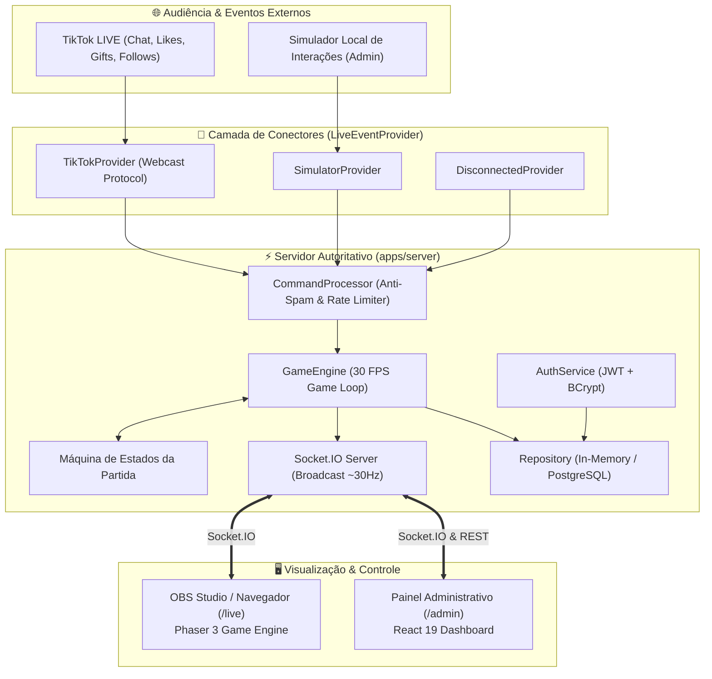
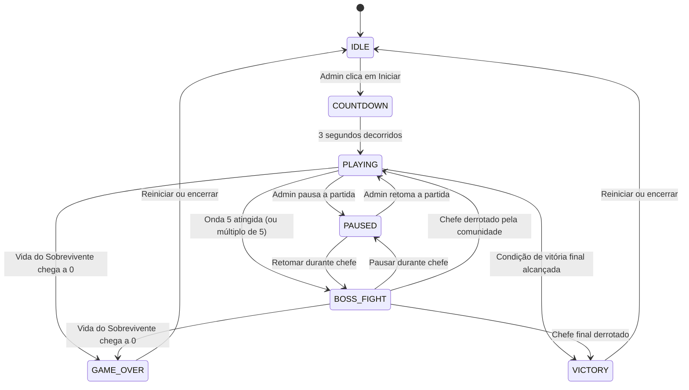

# 🏛️ Arquitetura do Sistema — ZOMBIE LIVE

## 1. Visão Geral da Arquitetura

O **ZOMBIE LIVE** adota um modelo de **Servidor Autoritativo com Renderização Desacoplada**. Todas as regras de negócio cruciais — como dano, colisões, pontos de vida, progressão de ondas, máquina de estados, contagem de votos e fila anti-spam de comandos — são processadas com autoridade exclusivamente no **Backend Node.js**.

O **Frontend do Jogo (Phaser 3)** e o **Painel Administrativo (React)** atuam como clientes de visualização e controle, conectando-se via WebSockets de alta velocidade (Socket.IO).



---

## 2. Separação de Responsabilidades (Monorepo)

O projeto é estruturado em um monorepo com pacotes especializados:

### `packages/shared`
- Contrato único de tipos TypeScript.
- Definição dos eventos de WebSocket (`SOCKET_EVENTS`).
- Modelos compartilhados: `GameStateSnapshot`, `SurvivorData`, `EnemyData`, `VoteSession`, `CollectiveGoal`.
- Garante integridade de dados e tipagem ponta a ponta sem duplicação de interfaces.

### `apps/server` (Backend Autoritativo)
- Executa o loop principal de simulação a 30 ticks por segundo.
- Gerencia a máquina de estados da partida.
- Contém a inteligência artificial do sobrevivente e dos zumbis.
- Normaliza e valida comandos do chat com proteção anti-spam e cooldown por usuário.
- Comunicação bidirecional em tempo real com clientes conectados.
- Persistência modular (armazenamento volátil em memória por padrão ou PostgreSQL quando configurado via `DATABASE_URL`).

### `apps/game` (Motor Gráfico & Transmissão)
- Desenvolvido em **Phaser 3** e empacotado com **Vite**.
- Responsável unicamente pela renderização fluida, interpolação de posições, animações de sprites, partículas e HUD.
- Rota limpa `/live` sem controles administrativos, preparada para captura no OBS Studio em 16:9 (1920x1080 / 1280x720).
- Todos os gráficos são gerados de forma procedimental (Canvas/Vector Graphics), dispensando downloads externos e prevenindo links corrompidos.

### `apps/admin` (Painel Administrativo)
- Desenvolvido em **React 19** com **Lucide Icons** e estilização CSS moderna em modo escuro.
- Totalmente em português brasileiro (PT-BR).
- Abas modulares:
  - **Dashboard**: Métricas em tempo real e feed de comandos.
  - **Partida & Habilidades**: Início/pausa e disparo manual de feitiços.
  - **Simulador**: Injeção de eventos locais (curtidas, chat, presentes, seguidores).
  - **Configurações & TikTok**: Conexão com live real e ajuste de limites.
  - **Histórico**: Registro das partidas disputadas.
  - **Diagnóstico**: Telemetria de RAM, uptime e integridade da conexão.

---

## 3. Máquina de Estados da Partida

A transição de estados do jogo obedece rigorosamente ao seguinte autômato finito:



---

## 4. Camada de Conexão com a Live (`LiveEventProvider`)

A integração segue o padrão de projeto *Strategy/Adapter*, garantindo que o núcleo do jogo nunca fique acoplado a uma API específica:

```typescript
export interface ILiveEventProvider {
  readonly type: LiveProviderType; // 'SIMULATOR' | 'CONNECTED' | 'DISCONNECTED'
  connect(): Promise<void>;
  disconnect(): Promise<void>;
  getStatus(): ProviderStatus;
  subscribe(listener: (event: NormalizedLiveEvent) => void): () => void;
  emitSimulatedEvent?(event: Partial<NormalizedLiveEvent>): void;
}
```

- **`SimulatorProvider`**: Padrão do ambiente de desenvolvimento. Gera eventos artificiais a partir de botões no painel. Não exige conta no TikTok nem internet ativa.
- **`TikTokProvider`**: Integração com transmissões públicas do TikTok através da biblioteca comunitária `tiktok-live-connector`. Conecta via websocket/pooling público sem solicitar senhas ou tokens privados.
- **`DisconnectedProvider`**: Modo seguro que silencia eventos externos, permitindo partidas locais puras.

---

## 5. Estratégia de Persistência e Banco de Dados

1. **Modo Padrão (Sem Banco de Dados)**: A aplicação utiliza o `InMemoryRepository`. Toda a partida, histórico recente e usuário administrador inicial funcionam instantaneamente na memória RAM com zero dependência.
2. **Modo Persistente (PostgreSQL)**: Ao fornecer uma string de conexão `DATABASE_URL` no `.env`, o servidor inicializa automaticamente o `PostgresRepository`, executando as migrations que criam as tabelas `admins`, `game_settings`, `matches` e `command_logs`.
